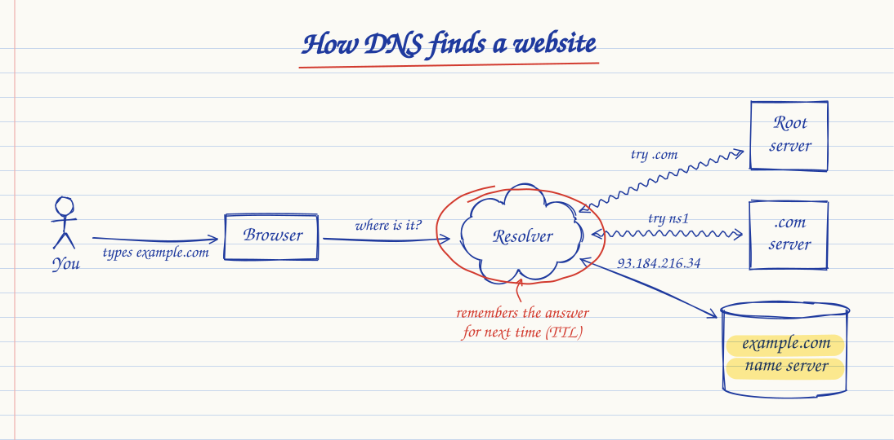
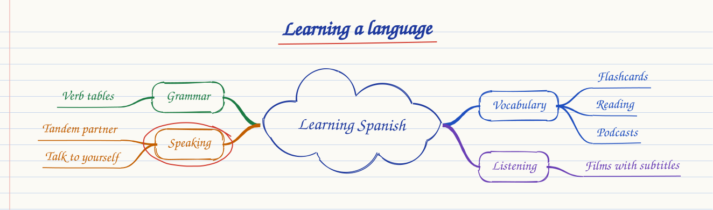
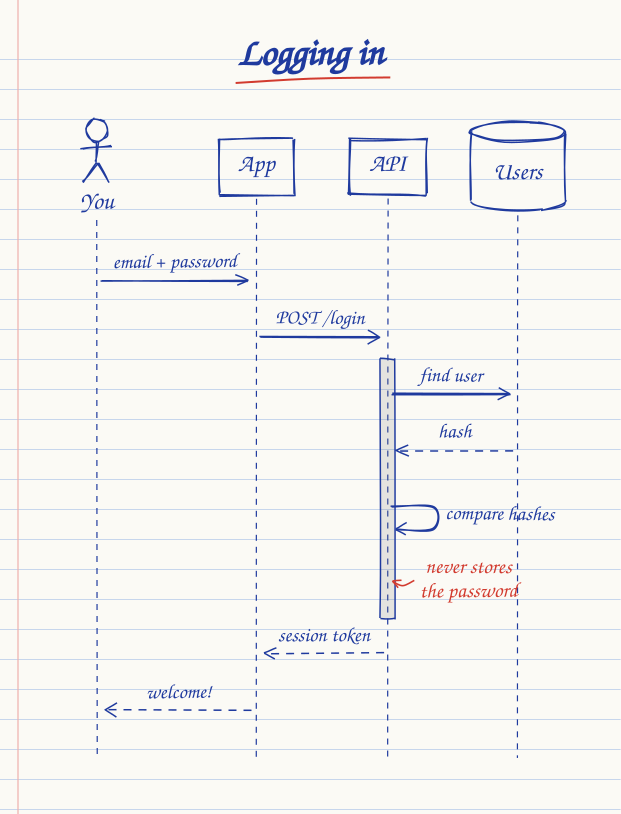
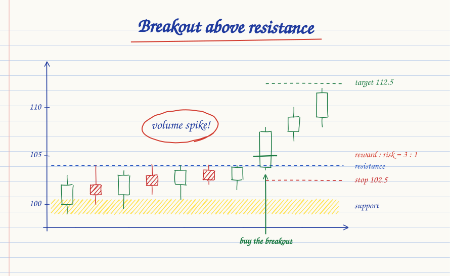

<p align="center">
  <picture>
    <source media="(prefers-color-scheme: dark)" srcset="brand/inkling-logo-dark.svg" />
    
  </picture>
</p>

<p align="center">
  Write a diagram as text, get a drawing that looks hand-made — and can draw itself step by step.
</p>

<p align="center">
  <a href="https://shivarajbakale.github.io/inkling/"><b>Open the playground</b></a> ·
  <a href="#using-inkling-in-another-product">Use it in your product</a> ·
  <a href="PLAN.md">Roadmap</a> ·
  <a href="LICENSE">MIT license</a>
</p>

<p align="center">
  
</p>

```
title "Request, then response"
paper notebook
browser: box "Browser"
server: round "Server"
browser -> server : "GET /"
server --> browser : "200 OK"
circle server
```

- **What it can draw:** boxes, clouds, databases, people, sticky notes and 30 icons; arrows of four kinds;
  groups; marks a teacher would make (circle, underline, highlight, notes, ticks); steps that animate.
- **Thirteen layouts:** `flow` (default), `free`, `stack`, `cycle`, `timeline`, `compare`, `mindmap`, `sequence`, `chart`
  (candlesticks, price lines and payoff diagrams with levels, trades, stops and targets),
  `tree` (org charts and other hierarchies), `state` (state machines with start and final dots),
  `venn` (two or three overlapping sets) and `quadrant` (2×2 grids). Sequence diagrams have
  `loop`, `opt`, `alt`/`else` and `par`/`and` frames.
  Examples of each are in `examples/templates/` and `examples/fixtures/`.
- **Playground app:** `npm install && npm run dev`, then open http://localhost:5173
- **Language reference:** the Syntax page in the playground, or `src/app/pages.tsx`
- **Roadmap:** [PLAN.md](PLAN.md)

## Using Inkling in another product

Inkling is not on the npm registry. The built library lives in `dist-lib/` and is
committed, so every commit and tag is a ready-to-use release.

| File | Use it for |
| --- | --- |
| `dist-lib/inkling.iife.js` | A classic `<script>` tag. Defines `window.Inkling` and `<inkling-diagram>`. |
| `dist-lib/inkling.js` | ES module for apps with a bundler (Vite, webpack, Next). |
| `dist-lib/types/` | TypeScript declarations. |
| `dist-lib/inkling-react.js` | [React component and hook](#react). Needs `react` from your app. |
| `dist-lib/inkling-remark.js` | [remark plugin](#markdown) for MDX, Astro, Docusaurus, Next and unified. |
| `dist-lib/inkling-markdown-it.js` | [markdown-it plugin](#markdown) for VitePress and other markdown-it setups. |
| `dist-lib/inkling-node.js` | `renderToSVG()` for Node, with a DOM shim bundled. Used by the plugins and the CLI. |
| `bin/inkling.mjs` | [Command line](#command-line): `render`, `check`, `format`. |

The core builds are self-contained (rough.js and dagre are bundled) and have no
framework dependency. About 36 KB gzipped. Each file has a `.d.ts` next to it.
`npm run vendor` copies all of them, plus `bin/`; a git dependency can import
`inkling/react`, `inkling/remark`, `inkling/markdown-it` and `inkling/node`.

### Option 1: copy it in (simplest)

From this repo:

```sh
npm run build:lib
npm run vendor -- ../your-app/src/vendor
```

This creates `../your-app/src/vendor/inkling/` with both builds, types and a
`VERSION` file naming the commit. Then in your app:

```ts
import { drawInto } from './vendor/inkling/inkling.js';

await drawInto(document.getElementById('diagram')!, source, { paper: 'napkin', animate: true });
```

Re-run `npm run vendor` to update.

### Option 2: a plain `<script>` tag

Serve `inkling.iife.js` from your own static files:

```html
<script src="/static/inkling.iife.js"></script>

<inkling-diagram autoplay>
  a -> b : "hello"
</inkling-diagram>
```

jsDelivr serves it straight from a GitHub tag, with no npm:

```html
<script src="https://cdn.jsdelivr.net/gh/shivarajbakale/inkling@v0.11.0/dist-lib/inkling.iife.js"></script>
```

### Option 3: git dependency

`package.json` points at `dist-lib/`, so a package manager can install straight
from git (still no registry):

```sh
npm install git+ssh://git@github.com/shivarajbakale/inkling.git#v0.11.0
# or from a local checkout:
npm install ../inkling
```

```ts
import { drawInto } from 'inkling';
```

### Option 4: git submodule

```sh
git submodule add https://github.com/shivarajbakale/inkling.git vendor/inkling
```

Then import `vendor/inkling/dist-lib/inkling.js`.

## The `<inkling-diagram>` element

```html
<inkling-diagram autoplay paper="chalkboard" pen="chalk" mess="0.6" seed="3" theme="dark">
  …source…
</inkling-diagram>
```

| Attribute | Meaning |
| --- | --- |
| `autoplay` | Draw itself when it scrolls into view. Ignored with reduced motion. |
| `controls="none"` | Hide the play bar. |
| `paper`, `pen`, `hand`, `mess`, `seed` | Override the matching line in the source. |
| `theme="light" \| "dark"` | Colour of the play bar. Defaults to the system setting. |
| `source="…"` | Source as an attribute instead of inner text. |

From script: `el.code = 'a -> b'` redraws it.

## The JavaScript API

```ts
import { drawInto, mount, parse, Player, setFontSource } from 'inkling';

// Draw, waiting for the handwriting fonts first.
const diagram = await drawInto(container, source, { paper: 'graph' });

diagram.steps;      // [{ index, caption, start, end }]
diagram.seek(1.2);  // show the drawing 1.2 s into its animation
diagram.toSVG();    // finished drawing as an SVG string

// Play controls
const player = new Player(diagram, (p) => console.log(p.t, p.stepIndex));
player.play();  player.next();  player.prev();  player.pause();

// Check source without drawing it
parse(source).diagnostics; // [{ code, severity, message, hint, fix, span }], see docs/errors.md

// Positions without ink, and a check for overlaps
checkScene(layout(parse(source))); // [] when nothing overlaps
```

`mount()` is the same as `drawInto()` without waiting for fonts. Use it when your
page already loads them.

### Rendering outside a browser

`render()` takes a `document` option, so it works in Node with a DOM shim such as
linkedom. Text is measured from built-in font metrics, so no canvas is needed.

```ts
import { parseHTML } from 'linkedom';
import { render } from 'inkling';

const { document } = parseHTML('<!doctype html><html><body></body></html>');
const { drawing } = render(source, {}, { document, idPrefix: 'd1' });
const svg = drawing.svg.outerHTML;
```

### Fonts

The handwriting fonts come from Google Fonts. Inkling adds the stylesheet link
itself the first time it draws. To self-host them (for a strict Content Security
Policy, or offline), call this before drawing:

```ts
setFontSource('/static/fonts/inkling-hands.css'); // your own @font-face file
setFontSource(null);                              // your page already loads them
```

The families are Caveat, Kalam, Patrick Hand, Gochi Hand and Architects
Daughter, all under the SIL Open Font License.

## React

```tsx
import { Inkling, useInkling, type InklingHandle } from './vendor/inkling/inkling-react.js';
// or, with a git dependency: from 'inkling/react'

const ref = useRef<InklingHandle>(null);

<Inkling
  source={source}
  paper="napkin"          // any setting overrides the source
  autoplay                // draw on first view
  controls                // built-in play bar (default); false for none
  step={step}             // controlled step, optional
  onStepChange={setStep}
  onReady={(diagram) => {}}
  onDiagnostics={(list) => {}}
  ref={ref}
/>

ref.current?.play();  ref.current?.next();  ref.current?.toSVG();
```

- **Server rendering:** safe. The server renders a box with the drawing's
  aspect ratio, the screen-reader description and any errors; the drawing
  appears on the client. Pass `ssrSvg={renderToSVG(source)}` (from
  `inkling-node.js`, at build time or in a server component) to show the
  finished drawing before JavaScript runs.
- The file starts with `'use client'`, so it works in Next.js server components.
- Keyboard: focus the diagram, then space plays or pauses and the arrow keys step.
- Theme the play bar with CSS variables on `.inkling` or a parent:
  `--inkling-accent`, `--inkling-text`, `--inkling-dim`, `--inkling-chrome`,
  `--inkling-dot`, `--inkling-error`, `--inkling-radius`.
- Fonts load from Google Fonts by default; `fontCss="/fonts.css"` or
  `fontCss={null}` (the page loads them) changes that.
- `useInkling(source, options)` returns `{ ref, diagram, diagnostics, player, state, doc }`
  for building your own controls: put `ref` on an empty `<div>`.

## Markdown

Write a fenced block:

````md
```inkling paper=chalkboard autoplay height=320 alt="How light becomes sugar"
title "Photosynthesis"
sun ~> leaf
```
````

Fence options: any setting (`paper`, `pen`, `hand`, `mess`, `seed`, `layout`),
`autoplay`, `controls=none`, `height`, `alt="…"` and `mode=client|svg`.

| Mode | Output | Needs |
| --- | --- | --- |
| `client` (default) | `<inkling-diagram>` with the source as escaped text. Animates. | `inkling.iife.js` on the page: load it yourself, or pass `injectScript: '/static/inkling.iife.js'`. |
| `svg` | `<figure class="inkling">` with the drawing inlined and the title as `<figcaption>`. | Nothing: no JavaScript, works in RSS and email. |

Plugin options: `mode`, `injectScript`, `strict` (fail the build on errors,
for CI; otherwise an error box is drawn and a warning logged), `hydrate`
(SVG mode: upgrade to an animated drawing when the script is present),
`fontCss` (SVG mode: your font stylesheet, or `null`), `embedFonts` (remark
only: fonts inside each SVG, fetched at build time).

```js
// unified: remark → Inkling → rehype
import remarkInkling from './vendor/inkling/inkling-remark.js';
unified().use(remarkParse).use(remarkInkling, { mode: 'svg' }).use(remarkRehype).use(rehypeStringify);

// Astro (astro.config.mjs; Astro 7 also needs @astrojs/markdown-remark installed)
markdown: { remarkPlugins: [[remarkInkling, { injectScript: '/inkling.iife.js' }]] }

// Docusaurus (docusaurus.config.mjs, in the classic preset)
docs: { remarkPlugins: [[remarkInkling, { strict: true }]] },   // and scripts: ['/inkling.iife.js']

// Next.js with @next/mdx: pass the plugin as an absolute path so Turbopack can load it
createMDX({ options: { remarkPlugins: [[`${here}/vendor/inkling/inkling-remark.js`, {}]] } })

// VitePress (markdown-it). Vue drops <script> and <style> in pages, so load
// the script and fonts in `head` and mark diagrams v-pre:
import inklingMarkdownIt from './vendor/inkling/inkling-markdown-it.js';
markdown: { config: (md) => md.use(inklingMarkdownIt, { vue: true, fontCss: null }) },
vue: { template: { compilerOptions: { isCustomElement: (t) => t === 'inkling-diagram' } } }
```

The remark plugin outputs hast, not raw HTML, so it needs no
`allowDangerousHtml` and works in MDX. Working sites for each are in
[`examples/sites/`](examples/sites): `npm run sites` builds the unified and
markdown-it ones; the others have their own `package.json`
(`cd examples/sites/astro && npm install && npm run build`).

### In Node

```js
import { renderToSVG, renderDiagram } from './vendor/inkling/inkling-node.js';

const svg = renderToSVG(source, { paper: 'napkin' });       // finished SVG string
const { svg: s, diagnostics, doc } = renderDiagram(source); // with everything known about it
```

Options: any setting, `idPrefix`, `fontCss`. `embedFonts(svg)` makes it self-contained.
The output matches the browser's drawing path for path.

## Command line

Runs with plain Node 18+ from a clone (`node bin/inkling.mjs`) or a vendored
copy (`node vendor/inkling/bin/inkling.mjs`). No install needed.

```sh
node bin/inkling.mjs render diagram.inkling -o diagram.svg --paper napkin --embed-fonts
node bin/inkling.mjs render 'docs/**/*.inkling'      # writes .svg next to each
node bin/inkling.mjs check diagram.inkling           # problems with a caret and the fix; exit 1 on errors
node bin/inkling.mjs format diagram.inkling --write  # or --check in CI
```

`check` prints each problem the way compilers do:

```
diagram.inkling:4: error: I don't understand this line. Did you mean "paper"? [E-UNKNOWN-LINE]
  4 | papr notebook
    | ^^^^^^^^^^^^^
    = fix: change "papr" to "paper"
```

`--brief` prints only the first line of each, for scripts. Every code is listed in
[`docs/errors.md`](docs/errors.md).

Good for GitHub READMEs: commit the `.svg` next to the source and show it as an
image. [`.github/workflows/render-diagrams.yml`](.github/workflows/render-diagrams.yml)
is an example workflow that re-renders changed `.inkling` files on pull requests.

For Claude Code, [`.claude/skills/inkling/SKILL.md`](.claude/skills/inkling/SKILL.md)
teaches the language and has Claude run `check` until a diagram is clean.

## Editor support

`bin/inkling-lsp.mjs` is a language server over stdio, with no dependencies
beyond a clone or vendored copy. It gives any editor that speaks the Language
Server Protocol the same help the playground has: problems as you type, one-click
fixes, completion (the file's own layout words first, set and square names after
`in`), hover help from the Syntax reference, formatting, go to definition and an
outline.

Neovim (0.11 or later), in `init.lua`:

```lua
vim.filetype.add({ extension = { inkling = 'inkling' } })
vim.lsp.config('inkling', { cmd = { 'node', '/path/to/inkling/bin/inkling-lsp.mjs' }, filetypes = { 'inkling' } })
vim.lsp.enable('inkling')
```

Helix, in `languages.toml`:

```toml
[language-server.inkling]
command = "node"
args = ["/path/to/inkling/bin/inkling-lsp.mjs"]

[[language]]
name = "inkling"
scope = "source.inkling"
file-types = ["inkling"]
comment-token = "#"
language-servers = ["inkling"]
```

Other editors: run `node /path/to/inkling/bin/inkling-lsp.mjs` as the server for
`.inkling` files. VS Code and Zed need a small extension to register the
language first; there isn't one yet.

The same help is in the core for other tools: `complete(source, offset)`,
`hover(source, offset)`, `symbols(source)` and `definition(source, offset)`,
exported from `inkling-node`.

## Project layout

```
src/core/        the renderer, no framework
  syntax/        tokenizer, parser (source positions, diagnostics), language reference
  complete.ts    completion, hover, symbols and definitions for editors
  layouts/       one file per layout; each returns a Scene
  humanise.ts    jitter and tilt, then arrow routing
  draw/          ink: paper, text, nodes, arrows, marks, schedule
  metrics.generated.ts   font widths, made by `npm run metrics`
src/embed/       the <inkling-diagram> web component
src/react/       the React component and hook
src/markdown/    remark and markdown-it plugins (one shared fence renderer)
src/node/        renderToSVG for Node, and reading setting overrides
src/lib.ts       library entry point (what dist-lib/inkling.js is built from)
bin/             the command line and the language server
examples/sites/  fixture sites: unified, markdown-it, Astro, VitePress, Docusaurus, Next
src/app/         the playground (React + Mantine)
examples/        standalone.html: the library in a page with no build step
scripts/         vendor.mjs (copy into other projects), artifact.mjs
tests/           unit, golden SVG, invariant, fuzz, Node and speed tests
tests/golden/    reference drawings; `npm run test:update` rewrites them
dist-lib/        built library, committed
```

## Scripts

| Command | Does |
| --- | --- |
| `npm run dev` | Playground with hot reload |
| `npm run build:lib` | Rebuild `dist-lib/` (core, React, remark, markdown-it, Node, types) |
| `npm run sites` | Build the unified and markdown-it fixture sites with `dist-lib/` |
| `npm run vendor -- <dir>` | Copy the library into another project |
| `npm run build:single` | Playground as one HTML file in `dist-single/` |
| `npm test` | All tests |
| `npm run test:update` | Accept intended drawing changes (review the SVG diff) |
| `npm run check` | Type-check, test and build the library: run before every release |
| `npm run metrics` | Re-measure the fonts (needs Playwright) |
| `npm run typecheck` | Type-check everything |

## More drawings

<p align="center">
  
  
</p>

<p align="center">
  
</p>

All of `examples/gallery/` opens in the playground's Examples page.

## Logo

The mark is a hand-drawn loop around a point of ink, the circle you draw round the thing that matters.
Files are in `brand/`: colour, dark, black and white marks, the horizontal logo, and favicon and app icons
in `brand/icons/`. The wordmark is Kalam Bold (SIL Open Font License), converted to outlines.

## License

[MIT](LICENSE) © 2026 Shivaraj Bakale
